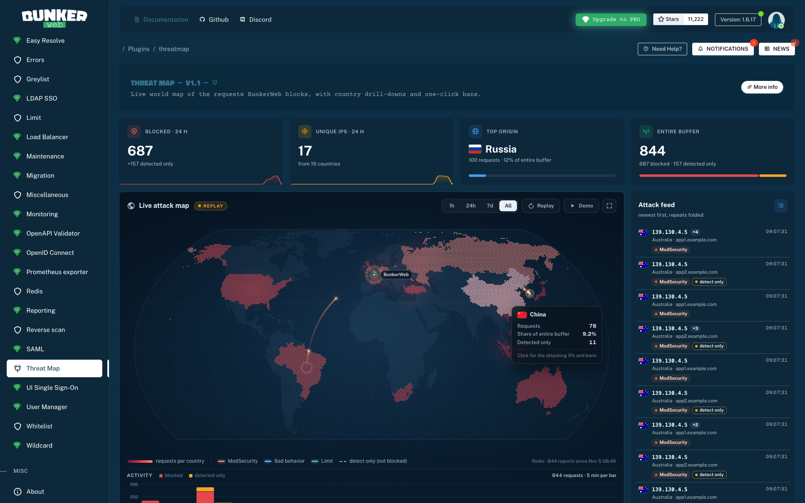
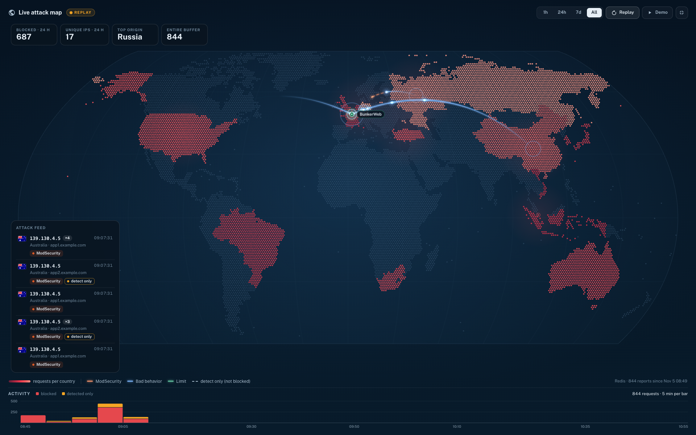
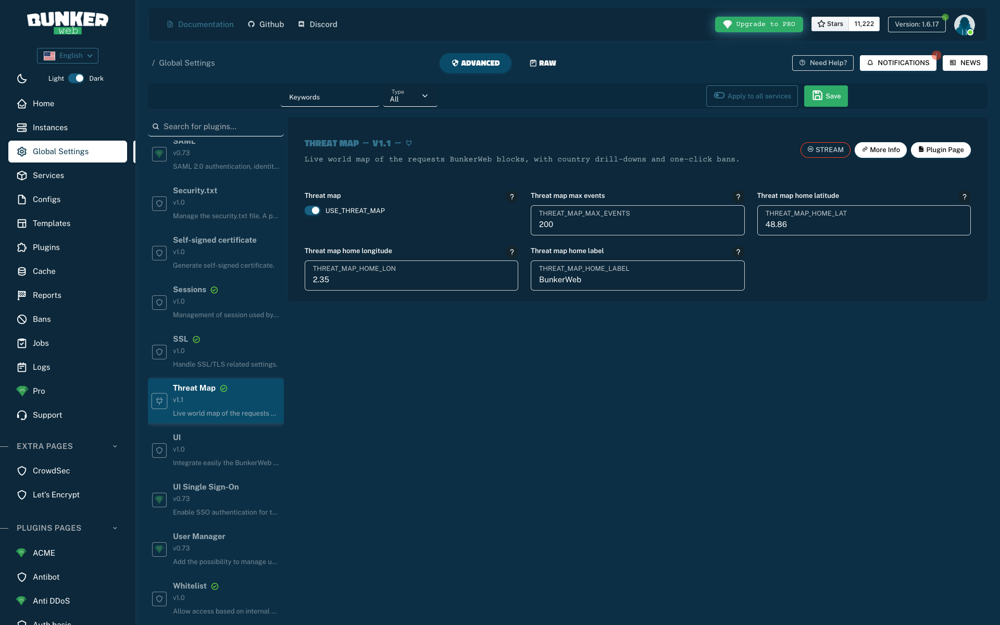

# Threat Map: BunkerWeb plugin

[](https://github.com/ssnrshnn/threatMapPlugin/actions/workflows/ci.yml)
[](LICENSE)

A live world **threat map** for the [BunkerWeb](https://www.bunkerweb.io) web UI. It turns the blocked-request reports your BunkerWeb instances already collect into an animated map of the attacks against your infrastructure: attack arcs, a live feed, per-country, per-reason and per-service statistics, a time-windowed activity timeline, country drill-downs with one-click bans and a SOC wall mode.

The map is **self-contained**: the world is drawn from [Natural Earth](https://www.naturalearthdata.com/) data embedded in the page (17 KB), with no CDN and no external request, so it works behind the UI's strict CSP.



## Features

- **Natural Earth projection, hexagonal dot grid**: 15,800 land dots in the Natural Earth I projection; each dot knows which country it belongs to, so whole countries light up on a single-hue scale according to their share of the attacks and can be hovered and clicked.
- **Smooth 60 fps animation**: attack arcs with fading comet trails, glowing heads and impact ripples, drawn on a dedicated layer with pre-rendered glow sprites (no `shadowBlur`). New reports are spread over the polling interval with their real relative timing, so the map flows instead of bursting every 10 s.
- **Blocked vs detected**: requests that BunkerWeb only logged (`SECURITY_MODE=detect`) are counted apart and drawn with dashed arcs.
- **At a glance**: stat cards with hourly sparklines of the last 24 h, the top origin's share and the blocked / detected split; top countries, top attacking IPs, block reasons and targeted services; a live feed that folds repeated requests from the same address into one row.
- **Hover & drill-down**: hover a country for its numbers; click it for its top attacker IPs (count, last reason, service, last seen), its reasons and services, and **one-click bans** (1 h, 24 h, 7 d, 30 d or permanent; global or for one service). The ban state shown comes from the instances themselves, and the ban result reports the instances where it failed.
- **Time windows**: 1 h, 24 h, 7 d or the whole buffer, applied to the map, the charts, the timeline and the drill-downs. The timeline buckets are aligned on whole minutes and hours, so they don't slide between polls. Hover a bar for its exact interval.
- **Honest coverage**: the map tells you where the data comes from (Redis or in-memory buffers), how far back it goes, and when the Redis buffer is full and older reports were dropped. The "vs previous 24 h" trend is only shown when the buffer actually reaches back 48 h.
- **Replay & Demo**: replay the recorded attacks of the window, compressed but in their real order and rhythm, or run a demo with clearly labelled synthetic events (RFC 5737 addresses) that never touch the statistics.
- **SOC mode**: a wall-monitor view with overlay stat cards, a docked feed and auto-cycling country highlights. `Esc` closes the drill-down, then SOC mode.
- **Accessible & light**: follows the UI's light or dark theme (the map stays dark); reason colours are checked for colour-blind readers and always shown with their name; honours "reduce motion"; bars are keyboard-navigable; the page pauses when the tab is hidden; polling backs off when an instance is unreachable.



## Where the numbers come from

Nothing on the page is estimated or looked up again: every value is derived from BunkerWeb's own data.

| What                    | Source                                                                                                                                                                                                                                                                                                                                                    |
| ----------------------- | --------------------------------------------------------------------------------------------------------------------------------------------------------------------------------------------------------------------------------------------------------------------------------------------------------------------------------------------------------- |
| Blocked requests        | The reports of the **metrics** plugin, read through `get_reports_query`, the Redis-backed query of the official Reports page. It falls back to the per-instance buffers on older cores or when Redis is unavailable. Duplicates (the same request id seen twice) and future timestamps are dropped.                                                       |
| Country of a request    | The country BunkerWeb resolved **at request time** with its bundled GeoIP database. `LOCAL` means a private address, `UNKNOWN` a failed lookup.                                                                                                                                                                                                           |
| Blocked / detected      | The `security_mode` BunkerWeb stored with the report (`detect` means logged only).                                                                                                                                                                                                                                                                        |
| Reason names            | The display names of the plugins in BunkerWeb's database (`badbehavior` → "Bad behavior").                                                                                                                                                                                                                                                                |
| Ban state & bans        | `get_bans` / `ban` of the UI's instance helper, the same path as the Bans page.                                                                                                                                                                                                                                                                           |
| Map & country positions | Natural Earth v5.1.2 (public domain), pinned by commit and SHA-256 and rebuilt reproducibly by `tools/build_geo.py`. Arcs start at Natural Earth's label point of each country (the visual centre of its main landmass). Overseas regions such as French Guiana (GF) or Réunion (RE) are kept apart from their sovereign, as GeoIP databases report them. |
| Country names           | Your browser's `Intl.DisplayNames` (CLDR), in the UI language.                                                                                                                                                                                                                                                                                            |

Statistics always cover every stored report. `THREAT_MAP_MAX_EVENTS` only limits how many individual events are sent to the browser for the animation, the feed and replays.

> **Buffer size matters.** Without Redis, each worker of each instance keeps its last `METRICS_MAX_BLOCKED_REQUESTS` reports (1,000 by default) in memory, and a reload clears them. With the Redis plugin enabled, the last `METRICS_MAX_BLOCKED_REQUESTS_REDIS` reports (10,000 by default) survive reloads and the 7-day window becomes meaningful. The map's footer shows which case you are in.

## Requirements

- BunkerWeb **1.6.12 or later** (tested on 1.6.17), with the web UI.
- `USE_METRICS=yes` (the default).
- Recommended: the **Redis** plugin (`USE_REDIS=yes`) for history that survives reloads.
- Live updates, drill-downs and bans are POST actions, which BunkerWeb restricts to **admin** accounts. Other accounts see a snapshot taken when the page loaded (the badge says `SNAPSHOT`).

## Installation

The `threatmap/` folder **is** the plugin. Its name must stay `threatmap`, matching the plugin `id`.

### From a release (recommended)

Point BunkerWeb at the release archive:

```env
EXTERNAL_PLUGIN_URLS=https://github.com/ssnrshnn/threatMapPlugin/releases/latest/download/threatmap.tar.gz
```

### Docker / Autoconf / Kubernetes

Copy the folder into the volume mounted on `/data/plugins` of the **scheduler**:

```bash
git clone https://github.com/ssnrshnn/threatMapPlugin.git
cp -r threatMapPlugin/threatmap /path/to/bw-data/plugins/
```

### Linux

```bash
cp -r threatmap /etc/bunkerweb/plugins/
systemctl restart bunkerweb-scheduler
```

Then open the web UI → **Plugins → Threat Map**.

> After adding or updating the plugin, restart **both** the scheduler and the web UI: the UI loads external plugin pages when it starts.

## Settings

| Setting                 | Default     | Context | Description                                                                                                                              |
| ----------------------- | ----------- | ------- | ---------------------------------------------------------------------------------------------------------------------------------------- |
| `USE_THREAT_MAP`        | `yes`       | global  | Enable the threat map page in the web UI.                                                                                                |
| `THREAT_MAP_MAX_EVENTS` | `200`       | global  | Recent blocked requests sent to the browser for the animation, the feed and replays (clamped to 1 to 2,000). Statistics are not limited. |
| `THREAT_MAP_HOME_LAT`   | `48.86`     | global  | Latitude (-90 to 90) of your infrastructure, where the arcs land.                                                                        |
| `THREAT_MAP_HOME_LON`   | `2.35`      | global  | Longitude (-180 to 180) of your infrastructure, where the arcs land.                                                                     |
| `THREAT_MAP_HOME_LABEL` | `BunkerWeb` | global  | Label shown next to the home marker (up to 32 characters).                                                                               |

All settings are editable in the web UI under **Global Settings → Threat Map**:



## Try it locally

A complete stack lives in [`examples/`](examples/): BunkerWeb 1.6.17, scheduler, UI, MariaDB, Redis, a syslog collector and a demo backend. It runs two services: `app1` blocks and `app2` only detects, so both kinds of events show up.

```bash
cd examples
docker compose up -d          # on macOS the AirPlay receiver owns port 7000: UI_PORT=7001 docker compose up -d
./traffic.sh 3                # harmless WAF-tripping requests from 16 spoofed source addresses
```

Then browse to **http://localhost:7000** (or your `UI_PORT`), log in with the dev credentials `admin` / `P@ssw0rd` and open **Plugins → Threat Map**.

> The example stack binds its ports to `127.0.0.1` only and trusts any `X-Forwarded-For` (`REAL_IP_FROM: 0.0.0.0/0`) **purely so that attacks from arbitrary countries can be simulated**. Never use that setting in production.

## Development

```bash
python3 -m venv .venv && .venv/bin/pip install pytest jinja2 black flake8
.venv/bin/pytest -q                      # actions, template rendering, map data integrity
.venv/bin/black --check . && .venv/bin/flake8
npx prettier@3.9.4 --check "threatmap/**/*.{js,css,json,md}" "*.md"
python3 tools/build_geo.py               # rebuild threatmap/ui/threatmap-geo.json (downloads Natural Earth)
python3 tools/build_geo.py --check       # CI: the committed map data must be reproducible
```

CI runs all of the above. Pushing a `v<version>` tag that matches `plugin.json` publishes a release with `threatmap.tar.gz`, ready for `EXTERNAL_PLUGIN_URLS`.

## Repository layout

```
threatmap/                 The plugin: drop this folder into /data/plugins
  plugin.json              Metadata & settings schema
  README.md                Plugin documentation
  ui/
    actions.py             Server side: report aggregation, drill-down, bans
    template.html          Page markup (Jinja), includes the files below
    threatmap.js           Map renderer & page logic
    threatmap.css          Styles
    threatmap-geo.json     Generated map data (Natural Earth, see tools/)
tools/build_geo.py         Reproducible generator of the map data
tests/                     pytest suite
examples/                  Local test stack & traffic generator (not shipped)
Screenshots/               Images used in this README
```

## License

Licensed under the **GNU AGPL-3.0** (matching BunkerWeb). See [`LICENSE`](LICENSE).

## Acknowledgements

- Built for [BunkerWeb](https://github.com/bunkerity/bunkerweb) by Bunkerity.
- Map data from [Natural Earth](https://www.naturalearthdata.com/) (public domain); Natural Earth I projection by Šavrič, Jenny, Patterson, Petrovič and Hurni (2011).
